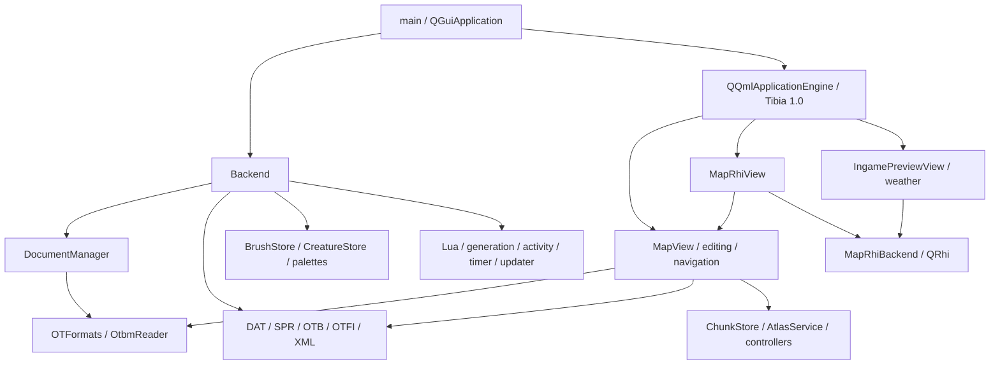
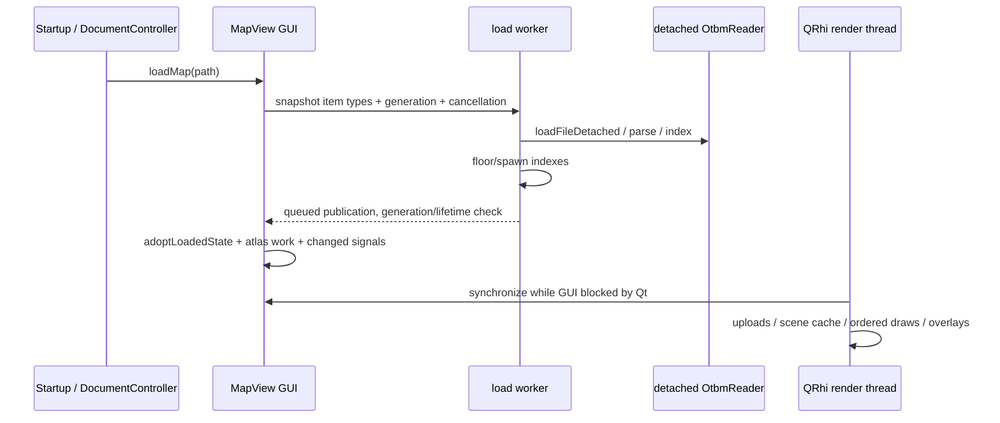
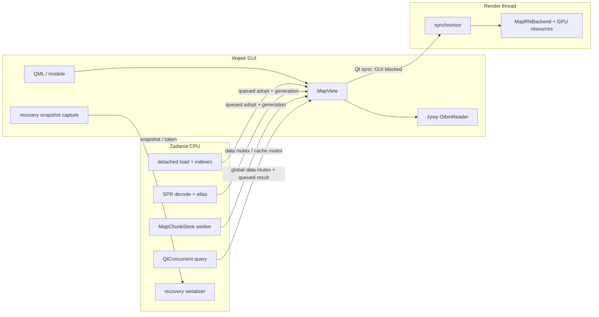

# Architektura obecna — audyt źródłowy DME

## Zakres, pochodzenie i poziom pewności

Audyt: 2026-10-26. Bazowy lokalny HEAD: `de764f5a85566d412622d27ee96fc443776195af`; 155 pozycji zmienionych/nieśledzonych w momencie rozpoznania. Analiza dotyczy tego drzewa roboczego, nie wyłącznie publicznego `main`. Publiczny CMake także deklarował C++17. Nie synchronizowano i nie modyfikowano GitHub/main.

Inwentarz obejmuje 1045 wcześniejszych plików i 489 plików kodu/skryptów/builda. Katalogi: core 62 pliki, map 56, preview 16, QML 282, otformats 29, tests 132, activity 31. To liczba zinwentaryzowanych plików, **nie deklaracja przeczytania każdej linii ani formalnego dowodu bezpieczeństwa**. Dokumenty opisują wszystkie główne granice systemu; miejsca z niepełną weryfikacją są wskazane niżej.

Oznaczenia: **fakt** — bezpośrednio z kodu; **reprodukcja** — wykonany eksperyment; **pomiar** — wykonany benchmark o podanych warunkach; **hipoteza** — wymaga walidacji; **niezweryfikowane** — brak odpowiedniego testu/inspekcji. Nie zmieniano aplikacji ani UI.

## Nawigacja po raporcie

| Dokument | Zakres faz |
|---|---|
| [map-data-analysis.md](map-data-analysis.md) | Fazy 2, 5, 10: model mapy, indeksy, historia i serializacja |
| [qrhi-rendering-audit.md](qrhi-rendering-audit.md) | Faza 3: kompletna główna ścieżka QRhi i Preview |
| [editor-tools-audit.md](editor-tools-audit.md) | Fazy 4–5: narzędzia, transakcje, selekcje, undo/redo |
| [memory-analysis.md](memory-analysis.md) | Fazy 6, 8–9: zasoby klienta, pamięć i zadania |
| [qt-qml-audit.md](qt-qml-audit.md) | Faza 7: C++–QML, modele i wątek GUI |
| [performance-benchmarks.md](performance-benchmarks.md) | Faza 12: wykonane pomiary, kontrole i braki |
| [target-architecture.md](target-architecture.md) | Faza 11: proponowane granice bez nowego renderera |
| [migration-roadmap.md](migration-roadmap.md) | Faza 13: priorytety, testy, ryzyko i rollback |

Dalszy etap: [odzyskiwanie, backupy i koszt zaznaczania — 2026-10-27](continuation-2026-10-27.md). Zawiera trzy nowe odtworzone błędy i pomiar F06 po wdrożeniu wcześniejszych poprawek.

## Moduły i zależności

## Przepływ runtime

## Kontrakty głównych podsystemów

### A. Proces, bootstrap i zamykanie

| Pole | Ustalenie |
|---|---|
| Odpowiedzialność | Uruchomienie Qt, wybór backendu i VSync, silnik QML, diagnostyka. |
| Źródła / wejście | [editor/main.cpp:67](../../editor/main.cpp#L67); [editor/main.cpp:120](../../editor/main.cpp#L120); [editor/map/mapview_edit.cpp:259](../../editor/map/mapview_edit.cpp#L259) |
| Zależności | QGuiApplication, QSettings, QQuickWindow, Backend, silnik QML. |
| Interfejsy | `main`, `--smoke-test`, `--load-profile`, image providery `tibiaui` i `paletteitem`. |
| Przepływ runtime | Ustawienia grafiki → aplikacja → Backend → engine → `qrc:/qml/Main.qml`. |
| Własność zasobów | Backend i engine na stosie; obiekty UI przez engine/Qt; QRhi przez renderery. |
| Inicjalizacja / destrukcja | Engine powstaje po Backend i jest niszczony wcześniej. `MapView` anuluje zadania i czeka na query/terrain; `DocumentManager` czeka na recovery. |
| Operacje kosztowne | Start profilu, utworzenie QML; przy zamykaniu oczekiwania na zadania. |
| Słabości / pewność | Zatrzymanie zadań jest bezpieczniejsze od porzucenia, ale może wydłużyć shutdown; nie zmierzono skrajnego czasu zamykania. |
| Możliwa poprawa | Jednolite rejestrowanie outstanding jobs i czasu zamykania; bez usuwania obecnych guardów. |

### B. Usługi aplikacji i dokumenty

| Pole | Ustalenie |
|---|---|
| Odpowiedzialność | Singleton udostępniający czytniki/usługi; karty, tożsamość dokumentu i odzyskiwanie. |
| Źródła / wejście | [editor/core/backend.cpp:33](../../editor/core/backend.cpp#L33); [editor/core/backend.h:36](../../editor/core/backend.h#L36); [editor/core/documentmanager.cpp:32](../../editor/core/documentmanager.cpp#L32) |
| Zależności | OTFormats, stores, timers, sieć, QtConcurrent i QSettings. |
| Interfejsy | `Backend` Q_PROPERTY, `DocumentManager::newDocument/closeDocument/current`, `autosaveNow`. |
| Przepływ runtime | Zmiana karty → aktualny czytnik → binding `MapView.otbm`; recovery kopiuje stan i publikuje wynik po epoce. |
| Własność zasobów | Backend ma usługi jako pola; dokumenty zarządza DocumentManager; watcher trzyma snapshot, QPointer dokumentu i epoch. |
| Inicjalizacja / destrukcja | `Backend::create` sprawdza thread i ustawia CppOwnership. Zamykanie dokumentu unieważnia recovery; destruktor czeka na zapis. |
| Operacje kosztowne | Kopia wszystkich kafelków recovery w GUI przed zleceniem zapisu. |
| Słabości / pewność | Potwierdzony koszt strukturalny pełnego snapshotu; liczby w benchmarkach. Nie oznacza wyścigu: snapshot odcina żywe dane. |
| Możliwa poprawa | Najpierw budżet/liczniki snapshotu; później wersjonowane snapshoty chunków, jeżeli pomiar uzasadni. |

### C. Generatory, Lua i zewnętrzny proces

| Pole | Ustalenie |
|---|---|
| Odpowiedzialność | Generowanie materiałów/patchy i ich zatwierdzanie jako edycji. |
| Źródła / wejście | [editor/core/luascriptengine.cpp:222](../../editor/core/luascriptengine.cpp#L222); [editor/map/mapview_lua.cpp:70](../../editor/map/mapview_lua.cpp#L70); [editor/core/tilemapgenprocess.cpp:35](../../editor/core/tilemapgenprocess.cpp#L35) |
| Zależności | Wbudowana Lua 5.1, QtConcurrent, MapView, profile i zewnętrzny Tile Map Generator opcjonalnie. |
| Interfejsy | `LuaScriptEngine`, `MapView::prepareLuaPatch/applyLuaPatch`, `TileMapGenBridge`, `GenerationLibrary`. |
| Przepływ runtime | Parametry/seed → odłączony wynik → walidacja → zastosowanie patcha w transakcji → undo/invalidation. |
| Własność zasobów | Stan Lua/wynik w zadaniu; żywa mapa pozostaje po stronie edytora. QProcess ma określony właścicielski wrapper. |
| Inicjalizacja / destrukcja | Cancel + watcher wait dla Lua; proces ma ścieżkę terminate/kill z timeout. Apply wykonuje się w GUI. |
| Operacje kosztowne | Konwersje QVariant patcha, walidacja i commit dużej liczby kafelków; ścieżki apply mogą długo trzymać data mutex. |
| Słabości / pewność | Zbadano orchestration i apply; nie zweryfikowano jakości wszystkich algorytmów generacji ani zewnętrznego generatora. |
| Możliwa poprawa | Etapowany immutable patch i jeden ChangeSet; nie przenosić niezsynchronizowanej mutacji mapy na worker. |

### D. Build, dystrybucja i zależności

| Pole | Ustalenie |
|---|---|
| Odpowiedzialność | Biblioteki statyczne, aplikacja, updater, zasoby, shadery i testy. |
| Źródła / wejście | [CMakeLists.txt:13](../../CMakeLists.txt#L13); [CMakeLists.txt:229](../../CMakeLists.txt#L229); [.github/workflows/release.yml:5](../../.github/workflows/release.yml#L5) |
| Zależności | CMake >=3.24; deklaracja Qt >=6.7 z GuiPrivate/ShaderTools; CI Qt6.10.2; vcpkg lub lokalny SDK. |
| Interfejsy | `DewralMapEditor`, `OTFormats`, `DmeLuaScripts`, `DmeLzma`, testy EXCLUDE_FROM_ALL i Windows `package_all`. |
| Przepływ runtime | C++/moc/qrc/qsb → DME → deployment Qt/data → archiwa/manifest → publikacja CI na main. |
| Własność zasobów | Build directory/cache zawiera lokalny toolchain i wynik; nie jest konfiguracją przenośną. |
| Inicjalizacja / destrukcja | Konfiguracja tworzy targety warunkowo. Runtime Qt musi pasować do private API kompilacji. |
| Operacje kosztowne | Duży target MapView jest ponownie kompilowany dla testów integracyjnych; post-build aplikacji kopiuje dane/runtime. |
| Słabości / pewność | F02: deklarowane minimum Qt nie pokrywa użytego `endFilterChange(Direction::Rows)` z Qt6.10. |
| Możliwa poprawa | Najpierw poprawić kontrakt wspieranych SDK; potem wydzielić współdzielone źródła do małej biblioteki/object targetu bez zmiany działania. |

## Mapa wątków i własności

Źródła: [editor/map/mapview.cpp:219](../../editor/map/mapview.cpp#L219); [editor/map/mapview_atlas.cpp:153](../../editor/map/mapview_atlas.cpp#L153); [editor/map/mapview_chunks.cpp:243](../../editor/map/mapview_chunks.cpp#L243); [editor/map/mapview_query.cpp:295](../../editor/map/mapview_query.cpp#L295).

## Zakres zweryfikowany i luki

| Obszar | Wykonano | Czego nie dowiedziono |
|---|---|---|
| Dane/IO/historia | Inspekcja magazynu i API; reprodukcja bounds; syntetyczne round-trip/bulk/undo/snapshot; istniejące testy | Odporność na wszystkie uszkodzone pliki, OOM i awarie dysku/procesu |
| Renderer | Prześledzenie głównego viewportu i Preview; backend readback tests OpenGL/D3D11; syntetyczne warianty batching/cache | FPS/p95 interaktywnego viewportu dla prywatnych wielomilionowych map, GPU timestamps i device-loss injection |
| Assety | DAT/SPR/OTB/OTFI i profile, cache, atlas, wersje i async provider | Wszystkie rzeczywiste/custom klienty i podpisy; pełen fuzzing dekoderów |
| Narzędzia | Główne ścieżki ground/border/wall/selection/paste/erase/generation i transakcje | Każda kombinacja pędzla, materiału, piętra i UI gesture |
| QML | Bootstrap, granice stanu, modele, profile, powiadomienia, testy kluczowych przepływów | Profil wszystkich bindingów/delegatów i wszystkie konfiguracje DPI/motywów |
| Platform/services | Mapa wejść i lifetime, CMake/CI/updater/timer/activity | Pełen audyt bezpieczeństwa serwera activity, updatera, Lua, Windows chrome i vendor libraries |
| Zależności | Targety/linkowanie/licencje lokalizacji | Audyt implementacji całej Lua/LZMA/Qt i legalności każdego zewnętrznego assetu |

Nie uruchamiano GitHub Actions, aktualizacji klienta ani produkcyjnego panelu activity. Istniejące 14 testów przeszło, ale to nie certyfikacja całego produktu. Szczegóły i raw workloads znajdują się w dokumencie benchmarków.

## Kontrola końcowa artefaktów audytu

Utworzono 9 raportów i 15 plików pomocniczych benchmarków (źródła, skrypt i surowe wyniki). Zweryfikowano 149 lokalnych odnośników w Markdown oraz zamknięcie bloków kodu; 8 diagramów Mermaid obejmuje wymagane przepływy. Nie wykonywano osobnego renderowania diagramów. Porównanie SHA-256 wszystkich 1045 wcześniejszych plików z inwentarzem początkowym: **0 zmienionych**. Dotychczasowe zmiany użytkownika zachowano. `git diff --check` nie zgłosił błędów whitespace; Git wypisał ostrzeżenia normalizacji LF/CRLF istniejącego drzewa. Skrypt odtwarzający benchmarki wykonano w całości; 11 wskazanych targetów zbudowano i 14 testów zaliczono. Nie budowano ponownie całej aplikacji ani pełnego zestawu QML, ponieważ kod aplikacji nie był zmieniany.
