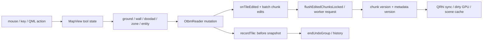
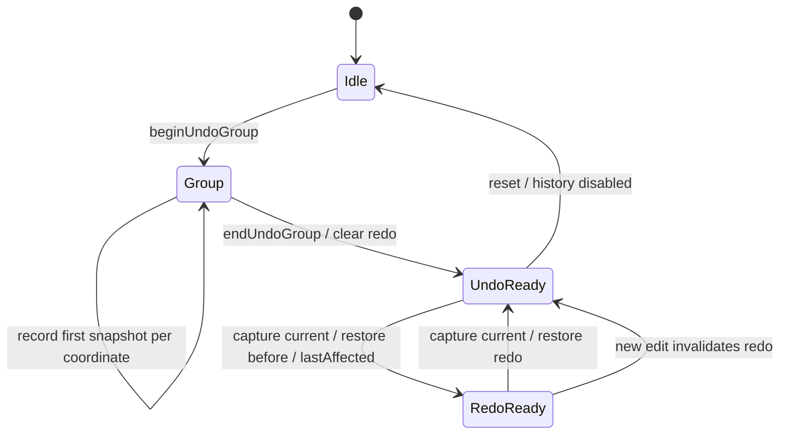

# Narzędzia edytora, zmiany mapy i Undo/Redo

## Obecna ścieżka edycji

Historia i render batching są dwiema różnymi granicami. `MapEditController` ma głębokość batcha; `OtbmReader` tylko bool undo grouping. Nie należy ich utożsamiać ani usuwać batchy, bo sygnał mapChanged nie zastępuje aktualizacji chunków.

### Input, narzędzia i pędzle

| Pole | Ustalenie |
|---|---|
| Odpowiedzialność | Przełożenie gestów na placement/erase/zone/creature/spawn oraz reguły materiałów. |
| Źródła / wejście | [editor/map/mapview_input.cpp:296](../../editor/map/mapview_input.cpp#L296); [editor/map/mapview_brush_core.cpp:535](../../editor/map/mapview_brush_core.cpp#L535); [editor/map/mapview_brush_types.cpp:343](../../editor/map/mapview_brush_types.cpp#L343) |
| Zależności | MapView, brush/navigation/edit controllers, BrushStore, OtbmReader i atlas. |
| Interfejsy | Mouse/key events, `paintAt`, `placeItemOnFloor`, ground/doodad/wall/carpet/table/door brush APIs. |
| Przepływ runtime | Gest → wybrany tool → mutacje z zachowaniem stosu/category/topOrder → tile change → cache invalidation. |
| Własność zasobów | Controller posiada stan narzędzia i touched cells; reader posiada wynik, BrushStore definicje. |
| Inicjalizacja / destrukcja | Mouse press otwiera undo; release/ungrab domyka. Zmiana dokumentu resetuje odpowiedni stan. |
| Operacje kosztowne | Duży stroke/drag-fill i przeliczanie sąsiadów odbywają się w GUI pod data mutex; sprite ensure jest wydzielone przed mutacją placement. |
| Słabości / pewność | Część wzorca begin/end/lock/notify jest powtórzona; to nie oznacza, że reguły wszystkich brushy można zunifikować bez testów. |
| Możliwa poprawa | Wspólna otoczka EditTransaction/ChangeSet dla istniejących algorytmów; deduplikacja kosztownego halo przy bulk edits. |

### Borders, wall connectivity i fill

| Pole | Ustalenie |
|---|---|
| Odpowiedzialność | Sąsiedztwo materiałów, optional borders, wall/corner/door warianty oraz prostokątny fill. |
| Źródła / wejście | [editor/map/mapview_brush_ground.cpp:96](../../editor/map/mapview_brush_ground.cpp#L96); [editor/map/mapview_brush_types.cpp:299](../../editor/map/mapview_brush_types.cpp#L299); [editor/core/brushstore.cpp:1504](../../editor/core/brushstore.cpp#L1504) |
| Zależności | BrushStore reguły i ID, tile ground, automagic/optional overrides. |
| Interfejsy | `recomputeBordersAt`, `recomputeWallAt`, `paintGroundBrushAt`, `drawDragRect`. |
| Przepływ runtime | Odczyt środka +8 sąsiadów → dobór reguł → porównanie istniejących borders → mutacja tylko przy różnicy. |
| Własność zasobów | Definicje w BrushStore; wynik w items; overrides/tool state w MapView. |
| Inicjalizacja / destrukcja | Profile przeładowują reguły. Stare overrides są czyszczone/resetowane przy odpowiednich operacjach mapy. |
| Operacje kosztowne | Nakładające się halo i lookup/stringy dla sąsiadów; fill jest pętlą regionu, nie niezależnym workerem. |
| Słabości / pewność | Istnieje już early return oldBorders==newBorders i ograniczenie recompute w dragFill. Nie potwierdzono osobnego generic flood-fill publicznego API. |
| Możliwa poprawa | Mierzyć liczby recompute, różne rozmiary stroke i materiały. Nie usuwać odwrócenia kolejności border IDs ani optional-state bez dowodu równoważności. |

### Selection, copy/paste i multi-floor

| Pole | Ustalenie |
|---|---|
| Odpowiedzialność | Tile/entity selection, rubber band/lasso, clipboard, move/rotate i zmiana pięter. |
| Źródła / wejście | [editor/map/mapview_input.cpp:154](../../editor/map/mapview_input.cpp#L154); [editor/map/mapview_selection.cpp:71](../../editor/map/mapview_selection.cpp#L71); [editor/map/mapview_selection.cpp:869](../../editor/map/mapview_selection.cpp#L869) |
| Zależności | MapSelectionController, reader, floor compensation, edit batching i sprite ensure. |
| Interfejsy | `clearSelection`, rubber/lasso, `copySelection/cutSelection`, `commitPasteAt` i transformacje zaznaczenia. |
| Przepływ runtime | Pozycje/entities → kopie item/metadata z relatywnym dx/dy/dz → walidacja floor range → grouped mutate. |
| Własność zasobów | Selection controller posiada QSet/entities i clipboard deep copies; renderer czyta stan do overlays. |
| Inicjalizacja / destrukcja | Clipboard jest lokalny dla edytora; paste/move ma osobną granicę transakcji; release kończy gesture. |
| Operacje kosztowne | Kopie rare item extras i QSet lookup; rubber band iteruje każdy slot bounding rectangle na wybranych piętrach. |
| Słabości / pewność | F06: koszt zaznaczania zależy od powierzchni regionu, nie tylko liczby istniejących tile; na rzadkich światach może być ogromny. Nie zmierzono realnego UI stall. |
| Możliwa poprawa | Region iterator oparty na istniejącym floor/chunk index z identycznym wynikiem i kompensacją pięter; test pustych obszarów i entity selection. |

### Historia i granice transakcji

| Pole | Ustalenie |
|---|---|
| Odpowiedzialność | Odwracalne operacje tile/house oraz koalescencja jednego gestu. |
| Źródła / wejście | [libs/otformats/otbmreader.cpp:2728](../../libs/otformats/otbmreader.cpp#L2728); [libs/otformats/otbmreader.cpp:2876](../../libs/otformats/otbmreader.cpp#L2876); [libs/otformats/otbmreader.cpp:3001](../../libs/otformats/otbmreader.cpp#L3001) |
| Zależności | TileSnapshot/UndoAction, position index, item deep copy i lastAffected. |
| Interfejsy | `beginUndoGroup/endUndoGroup`, `recordTile`, `undo/redo`, `setUndoLimit`, `lastAffected`. |
| Przepływ runtime | Pierwsza mutacja pozycji zapisuje before; commit usuwa redo. Undo zapisuje current jako redo snapshot, odtwarza before, publikuje lastAffected. |
| Własność zasobów | Reader posiada deque history i byte estimates; snapshot ma własny vector items oraz kopie extra/children. |
| Inicjalizacja / destrukcja | Reset mapy czyści historię; trim stosuje count i budżet pamięci. Undo strukturalne naprawia pozycje i obserwatorów. |
| Operacje kosztowne | Kopiowanie pełnego tile nawet dla drobnej zmiany pola; undo/redo tworzą snapshot przeciwnego kierunku. |
| Słabości / pewność | F09: manual begin/end i brak kontraktu dla nested undo group/wyjątku w środku. 256 MiB to miękki limit: pozostaje co najmniej jedna akcja, nawet większa. |
| Możliwa poprawa | RAII guard bez zmiany algorytmów; delta dla prostych pól jako pomiarowy eksperyment, snapshot fallback dla containers/structural. |

## Cykl Undo/Redo

### Gwarancje i ograniczenia

- GroupRecorded deduplikuje przed-snapshot danej pozycji; nie ma kopii całej mapy przy zwykłej edycji. Pełna mapa jest kopiowana dla recovery, co jest innym mechanizmem.
- Byte estimates liczą dynamiczne children/strings; pamięć procesowa i allocator overhead mogą być większe. Jeden ogromny edit nie mieści się w twardym limicie, a odrzucenie go bez uzgodnienia oznaczałoby utratę undo.
- Zagnieżdżone `beginUndoGroup` resetuje aktualną grupę, ponieważ kontrakt opiera się na bool. Nie dowiedziono błędnego zagnieżdżenia w normalnym UI; to ryzyko rozwoju API. Guard musi zachować właściciela zewnętrznej transakcji.
- `std::bad_alloc` w środku wielotile'owej mutacji nie ma jawnego rollback całej operacji. Nie wykonano injection OOM; nie obiecujemy strong exception guarantee ani nie twierdzimy, że wykazano utratę danych w zwykłym użytkowaniu.
- `flushEditedChunksLocked` filtruje zmienione tile z cached quads, dopisuje nowe, stable-sortuje fragment i scala. Evicted/not-visible chunk trafia do workera zamiast pełnej przebudowy GUI. Obecna inkrementalność musi zostać zachowana.

Dowody: [libs/otformats/otbmreader.cpp:2840](../../libs/otformats/otbmreader.cpp#L2840); [libs/otformats/otbmreader.cpp:2876](../../libs/otformats/otbmreader.cpp#L2876); [editor/map/mapview_edit.cpp:309](../../editor/map/mapview_edit.cpp#L309).

## Proponowana wspólna granica — hipoteza

`Input → istniejący Tool/Brush → EditTransaction → Reader mutation → ChangeSet → history + minimap/spawn/chunk invalidation`.

ChangeSet powinien zawierać pozycje, relokacje, zmienione metadata i kategorie invalidation. Nie tworzyć klasy Command na każdy item, nowej hierarchii factories ani drugiego źródła stanu. Najpierw opakować jedną istniejącą operację, porównać wynik/undo/invalidation, dopiero przenosić kolejne call sites. Warstwa modelu nie powinna wiedzieć o QRhi, a publiczne QML API może pozostać bez zmian.

Pomiary bulk z raportu dotyczą readera, nie pełnego stroke z borders, atlasem i repaintem. Potrzebne testy: nested/aborted transactions, release/ungrab/focus loss, paste poza 0..15 i 0..65535, duży sparse region, kontenery, domy/spawny, jedna akcja undo oraz cross-chunk invalidation.
