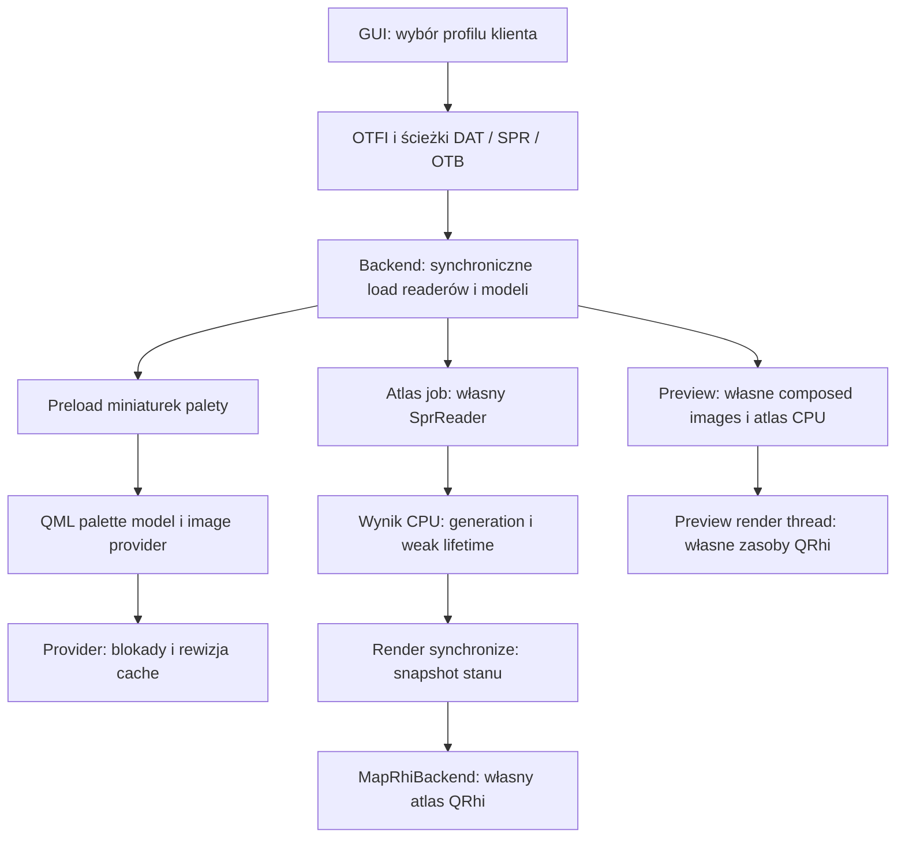

# Pamięć, assety i zadania asynchroniczne

## Kontrakty zasobów

### DAT / OTB / OTFI / XML i profile klienta

| Pole | Ustalenie |
|---|---|
| Odpowiedzialność | Definicje item/creature, mapowanie server→client, wersje i opcje formatu. |
| Źródła / wejście | [libs/otformats/datreader.cpp:99](../../libs/otformats/datreader.cpp#L99); [libs/otformats/otbreader.cpp:247](../../libs/otformats/otbreader.cpp#L247); [editor/qml/controllers/ClientProfileController.qml:212](../../editor/qml/controllers/ClientProfileController.qml#L212) |
| Zależności | BinaryReader/NodeFileReader, Qt modele, ClientItem/OtbItem, pliki użytkownika. |
| Interfejsy | `loadFile`, `itemByClientId`, `clientIdForServerId`, OTFI overrides, `ensureClientVersion`. |
| Przepływ runtime | Profil → ścieżki/OTFI → DAT+SPR+OTB → stores/XML → fingerprint → atlas/paleta. |
| Własność zasobów | Backend posiada modele/czytniki; profil QML przechowuje klucze i preferences. Fingerprint to tożsamość cache, nie podpis kryptograficzny. |
| Inicjalizacja / destrukcja | Ładowanie resetuje modele/indeksy. Klient może współdzielić reader dla wielu dokumentów, więc zmiana profilu wymaga skoordynowania zadań. |
| Operacje kosztowne | Load i przygotowanie palety wykonywane synchronicznie z ensureClientVersion; całościowe model resets są uzasadnione przy zmianie zasobu. |
| Słabości / pewność | F04/F05: ciężkie kroki GUI i wyniki z poprzedniego kontekstu. Nie testowano wszystkich realnych/custom klientów. |
| Możliwa poprawa | Detached AssetBundle z generacją i atomowym adopt w GUI; najpierw pomiar inicjalizacji oraz zachowanie starego profilu przy błędzie. |

### SPR, dekodowanie i miniatury

| Pole | Ustalenie |
|---|---|
| Odpowiedzialność | Dekodowanie sprite bytes oraz obrazy item/outfit dla palety i rendererów. |
| Źródła / wejście | [libs/otformats/sprreader.cpp:284](../../libs/otformats/sprreader.cpp#L284); [libs/otformats/sprreader.cpp:626](../../libs/otformats/sprreader.cpp#L626); [editor/core/paletteimageprovider.cpp:11](../../editor/core/paletteimageprovider.cpp#L11) |
| Zależności | QFile/mmap, SpriteData, QImage, DAT definitions; async Qt image provider. |
| Interfejsy | `loadSprite`, `loadSpriteUncached`, `beginBulkAccess/endBulkAccess`, preloadedItemImage(revision). |
| Przepływ runtime | offset table → decoded RGBA → composed item → immutable published thumbnail state → provider. |
| Własność zasobów | SprReader posiada plik, LRU i thumbnail snapshot. Provider obserwuje reader; preloaded state chroniony QReadWriteLock. |
| Inicjalizacja / destrukcja | Reset unmapuje plik i czyści cache; revision odrzuca stare żądania obrazów. Atlas worker używa odrębnego SprReader. |
| Operacje kosztowne | Dekodowanie i compositing wszystkich miniaturek; legacy data URLs kodują PNG/base64, podczas gdy normalna paleta korzysta z image provider. |
| Słabości / pewność | Miniatury są trwale przygotowane dla wszystkich definicji, niezależnie od widocznej strony. To trade-off RAM/start versus szybki scroll, nie brak cache. |
| Możliwa poprawa | Najpierw pomiar count/bytes/decode reuse. Opcjonalnie osobny visibility scan i lazy composed thumbnails z generation-aware bounded cache. |

### Atlas, quad cache i zasoby pochodne

| Pole | Ustalenie |
|---|---|
| Odpowiedzialność | Buforowanie geometrii, obrazów i danych GPU dla viewportu/Preview. |
| Źródła / wejście | [editor/map/mapservices.cpp:68](../../editor/map/mapservices.cpp#L68); [editor/map/mapservices.cpp:215](../../editor/map/mapservices.cpp#L215); [editor/preview/ingamepreviewscene.h:47](../../editor/preview/ingamepreviewscene.h#L47) |
| Zależności | Tile pointers, DAT/SPR, QuadRefs, QImage, QRhi per renderer. |
| Interfejsy | `cachedChunkLocked/storeChunkLocked`, atlas epoch/uploadSince, renderer staging. |
| Przepływ runtime | Tile IDs → sprite atlas/quads → CPU staging → niezależne GPU zasoby widoków. |
| Własność zasobów | 128 MiB quad-cache budget; refs mogą utrzymywać evicted geometry. CPU atlas jest autorytatywny, GPU atlas osobny na renderer. |
| Inicjalizacja / destrukcja | Client reset/epoch i chunk generation unieważniają dane. Wzrost atlasu może mieć jednocześnie stary i nowy obraz. |
| Operacje kosztowne | Copy-on-write QImage przy wzroście, upload całego atlasu po zmianie epoch, pipeline/buffer recreation. |
| Słabości / pewność | Budżety częściowe nie sumują się do twardego limitu procesu. History/quad cache zachowują jeden element nawet ponad budżetem. |
| Możliwa poprawa | Najpierw pełne rachunkowanie live/retained/staging/VRAM; paging lub pooling wyłącznie po wskazaniu dominującej kategorii. |

### Workers, synchronizacja i anulowanie

| Pole | Ustalenie |
|---|---|
| Odpowiedzialność | Load, atlas, query, chunk build, recovery i generatory bez blokowania GUI tam, gdzie wydzielono obliczenia. |
| Źródła / wejście | [editor/map/mapview.cpp:219](../../editor/map/mapview.cpp#L219); [editor/map/mapview_atlas.cpp:153](../../editor/map/mapview_atlas.cpp#L153); [editor/map/mapview_query.cpp:624](../../editor/map/mapview_query.cpp#L624); [editor/map/mapview_chunks.cpp:243](../../editor/map/mapview_chunks.cpp#L243) |
| Zależności | std::thread, QtConcurrent/watchers, QPointer/lifetime token, mutex/CV i epochs. |
| Interfejsy | load/atlas/query start+cancel, chunk request queue, autosave, generator APIs. |
| Przepływ runtime | Odłączone dane → zadanie → queued result. Chunk/query korzystają też ze współdzielonej mapy pod data mutex. |
| Własność zasobów | Load/atlas posiadają wynik przez shared_ptr; chunk worker jest joinowany; query future należy do MapView; recovery watcher do DocumentManager. |
| Inicjalizacja / destrukcja | Load/atlas odrzucają nieaktualne wyniki. MapView destructor czeka na query i terrain, DocumentManager na recovery. Detached load/atlas nie są joinowane. |
| Operacje kosztowne | Query trzyma data mutex przez pełny skan; GUI może czekać na niego w edycji/sync. Capture recovery pozostaje w GUI. |
| Słabości / pewność | F10: query nie wiąże wyniku z generacją dokumentu; setOtbm zmienia żywy pointer bez tego samego zamka/koordynacji. Ryzyko stale result i niesynchronizowanego dostępu. |
| Możliwa poprawa | Document-scoped task context i kontrola publication epoch; snapshot lub krótkie read chunks, bez naiwnego zdjęcia zamka i bez czekania GUI na całą mapę. |

## Rachunek pamięci — fakty i estymaty

| Kategoria | Mechanizm / wielkość | Ograniczenie interpretacji |
|---|---|---|
| Tile | 64×N B dla samych obiektów w tym buildzie | Deque blocks, indeksy, items>1 i extras dodatkowo |
| Item | 16 B, jeden mieści się inline w CompactVector | Każdy rare extra/children/string osobno |
| Dense position index | 1024×4 B/chunk, po progu 256 | Hash buckets i koszty przejściowej sparse konwersji dodatkowo |
| Renderer tile pointers | co najmniej sizeof(pointer)×N plus QHash/vector capacities | Dodatkowy indeks, nie nowe tile ownership |
| Quad cache | cel 128 MiB wg liczby quadów i LRU | Shared snapshots mogą przeżyć eviction; to nie całkowity RSS |
| Historia | 500 akcji domyślnie, wspólny limit 256 MiB | Przynajmniej jedna akcja pozostaje; duża transakcja i opposite snapshots są chwilowo równocześnie żywe |
| Sprite LRU | 8 MiB, data URL LRU 16 MiB | Miniatury i atlas są oddzielne od tych limitów |
| Paleta | suma retained QImage miniaturek wszystkich definicji | `thumbnailCacheBytes()` podaje pixel bytes, nie wszystkie alokacje |
| Główny atlas | 4096×H×4 B CPU + osobno każda tekstura GPU | Przy wzroście/COW stare+nowe obrazy i upload mogą współistnieć |
| Preview atlas | 2048²×4 = 16 MiB CPU + GPU na widok | Composed image QCache jest dodatkowy; max4096 entries, nie limit bajtowy |
| Scene cache GPU | około (framebufferW+2M)×(framebufferH+2M)×4 B | M zależy od DPI; output/depth/driver narzut osobno |
| Parser | mmap/readAll fallback + unescaped node data/tree + tiles | Nie należy sumować mmap jako identycznego resident heap bez pomiaru |
| Recovery | deep-copy tiles/extra/children przed zadaniem zapisu | Zmierzony snapshot 1 048 576 tile: mediana ~28.9 ms; nie obejmuje zapisu recovery |

Źródła limitów: [editor/map/mapservices.cpp:70](../../editor/map/mapservices.cpp#L70); [libs/otformats/otbmreader.h:600](../../libs/otformats/otbmreader.h#L600); [libs/otformats/sprreader.h:114](../../libs/otformats/sprreader.h#L114); [editor/preview/ingamepreviewview.cpp:196](../../editor/preview/ingamepreviewview.cpp#L196).

W osobnej próbie zmierzono próbkowany working set/CPU procesu benchmarku (patrz raport). Nie zmierzono dokładnego peak RSS per scena, VRAM, fragmentacji, cache hit ratios ani lock-contention trace; powyższa tabela nie jest takim pomiarem. Liczniki alokacji w benchmarku indeksu obejmują tylko new/new[] wariantów STL w harnessie, a nie Qt/malloc/driver całej aplikacji.

## F10 — tożsamość dokumentu przy zapytaniu w tle

`startItemSearch/startItemLocationSearch/startMapAnalysis` przechwytują `this`, a worker korzysta z `m_otbm` i innych żywych usług. Callback ustawia wynik bez tokenu dokumentu. `setOtbm` unieważnia map load, ale nie query, i przypisuje `m_otbm` przed chronionym `onMapLoaded`; zamknięcie dokumentu planuje `deleteLater`. Karty można zmieniać podczas zapytania. Globalny data mutex wewnątrz query nie chroni przypisania wykonanego poza nim.

Wniosek źródłowy: brak pełnego kontraktu lifetime/synchronizacji przy zmianie/close dokumentu; możliwy stale result, a podczas wyścigu także nieważny odczyt. **Nie wykonano TSan ani deterministycznej reprodukcji crasha.** Priorytet P1 do weryfikacji i usunięcia granicy niesynchronizowanego dostępu, nie deklaracja, że każdy switch powoduje crash.

Dowody: [editor/map/mapview_query.cpp:632](../../editor/map/mapview_query.cpp#L632); [editor/map/mapview_query.cpp:295](../../editor/map/mapview_query.cpp#L295); [editor/map/mapview.cpp:423](../../editor/map/mapview.cpp#L423); [editor/core/documentmanager.cpp:91](../../editor/core/documentmanager.cpp#L91); [editor/qml/components/DocumentTabs.qml:81](../../editor/qml/components/DocumentTabs.qml#L81).

## Kolejność modernizacji

RAII już występuje w zwykłych zasobach i QRhi. Nie wymieniać prawidłowego parent ownership QObject na shared_ptr. Najpierw zamknąć F01/F10 i kontrakt Qt SDK; potem zmierzone capture/save GUI. Następnie rozważyć bounded snapshot chunks, krótsze query locks i reuse staging. SoA, memory pools, C++20 span/jthread, wspólne tekstury między oknami i nowa pula wątków nie są automatycznymi ulepszeniami. C++20 wymaga oddzielnej zmiany standardu i walidacji; obecny CMake pozostaje C++17.

## Przepływ ładowania assetów i własność

Diagram rozróżnia aktualne ścieżki; nie obiecuje, że całe ładowanie profilu jest asynchroniczne. Cache miniaturek, cache dekodera SPR, atlas CPU i tekstury GPU mają odrębnych właścicieli. Źródła i reguły unieważniania opisano w kartach powyżej.
