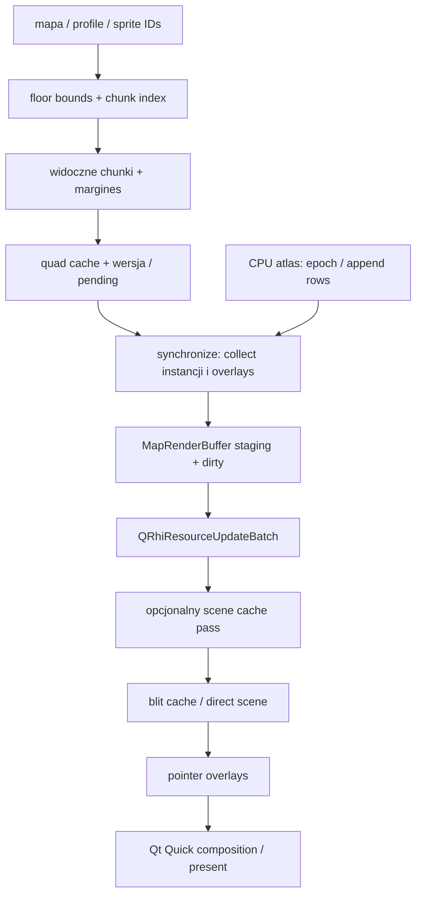

# Audyt QRhi i renderowania

## Status
QRhi pozostaje architekturą. Nie dodano API/backendu ani zmian produkcyjnych. Prześledzono `MapView` → `MapRhiView` → `MapRhiBackend` → Qt Quick oraz osobną ścieżkę Preview. Testy GPU OpenGL i D3D11 przeszły; syntetyczne warianty batching/cache miały identyczne końcowe piksele. To nie dowodzi poprawności wszystkich realnych scen i czasów viewportu.

### MapView → MapRhiRenderer

| Pole | Ustalenie |
|---|---|
| Odpowiedzialność | Culling, synchronizacja stanu, wersjonowanie, cache i kompozycja pięter. |
| Źródła / wejście | [editor/map/maprhiview.cpp:13](../../editor/map/maprhiview.cpp#L13); [editor/map/mapview_render.cpp:69](../../editor/map/mapview_render.cpp#L69) |
| Zależności | MapView render* API, MapChunkStore, AtlasService, light field, QQuickRhiItem. |
| Interfejsy | `createRenderer`, `initialize`, `synchronize`, `render`, `driverTick`. |
| Przepływ runtime | Region/zoom/piętra → lista chunk keys → cached/staged instancje → scena i pointer overlays → backend. |
| Własność zasobów | Renderer posiada backend, GPU/staging chunków, light grids i cache keys. GUI item posiada timery, atomowe pending/frame counters i source observer. |
| Inicjalizacja / destrukcja | Nowy QRhi resetuje backend/bufory/atlas; zmiana źródła resetuje indeksy i wersje. Qt zarządza rendererem na render thread. |
| Operacje kosztowne | Brakujące chunki, synchronize, zbieranie instancji, light field i overlay regeneration; statyczny cache ogranicza drawy. |
| Słabości / pewność | F05: pełny query pod data mutex może blokować synchronize/edycję. F07: lokalne draw vectors/tmp staging są kandydatami na reuse; nie wykazano zysku produkcyjnego. |
| Możliwa poprawa | Instrumentacja sync/lock wait/cache miss/bytes, a dopiero potem mały reuse scratch buffers. Zachować cache correctness. |

### MapRhiBackend i zasoby GPU

| Pole | Ustalenie |
|---|---|
| Odpowiedzialność | Uploady, pipeline/SRB/samplery, instancing, cache target i rejestrowanie drawów. |
| Źródła / wejście | [editor/map/maprhibackend.h:22](../../editor/map/maprhibackend.h#L22); [editor/map/maprhibackend.cpp:184](../../editor/map/maprhibackend.cpp#L184) |
| Zależności | Qt GuiPrivate/QRhi i baked map.vert/map.frag qsb. |
| Interfejsy | `setAtlas`, `setLight`, `ensureCache`, `render`, `MapRenderBuffer`. |
| Przepływ runtime | CPU staging → batch uploadów → pass cache gdy dirty → pass wyjściowy → drawy nakładek. |
| Własność zasobów | Backend posiada unique_ptr zasobów; QRhi* i command buffer to nieposiadające uchwyty Qt. Draws wskazują owned buffers ważne podczas render(). |
| Inicjalizacja / destrukcja | Pipeline/SRB/target zwalniane w destruktorze na render thread. Przy zmianie QRhi recreacja i upload CPU staging. |
| Operacje kosztowne | UBO staging per frame, updateDynamicBuffer dla dirty, rozrost buffer/texture, bindy per Draw. |
| Słabości / pewność | Jednoteksturowy atlas ma sprawdzany TextureSizeMax; przekroczenie usuwa atlas, render czyści wyjście. To granica pojemności, nie brak walidacji limitu. |
| Możliwa poprawa | Najpierw jawna diagnostyka pojemności i budżety; paging/array texture tylko po pomiarze i testach kolejności/zgodności sprzętu. |

### In-game Preview i pogoda

| Pole | Ustalenie |
|---|---|
| Odpowiedzialność | Własna kamera/gracz, scena, label/light oraz warstwa pogody bez modyfikowania edytowanej mapy. |
| Źródła / wejście | [editor/preview/ingamepreviewview.cpp:8](../../editor/preview/ingamepreviewview.cpp#L8); [editor/preview/ingamepreviewscene.cpp:213](../../editor/preview/ingamepreviewscene.cpp#L213); [editor/preview/weatherparticles.h:1](../../editor/preview/weatherparticles.h#L1) |
| Zależności | MapView jako dane źródłowe, PreviewController, CPU image cache, MapRhiBackend, weather layer. |
| Interfejsy | `setSource`, `refresh`, display properties, preview controller; build scene. |
| Przepływ runtime | Timer/UI state → scene.build → composed images → patch atlas 2048² → instancje → własny QRhi renderer. |
| Własność zasobów | Preview posiada frame, slots/cache i atlas CPU; renderer własny atlas GPU. Nie współdzieli natywnego uchwytu głównego viewportu. |
| Inicjalizacja / destrukcja | Reset assets przy zmianie czytników/atlasu; atlas revision steruje uploadem. Timer odświeża tylko aktywny widok. |
| Operacje kosztowne | Scene build pod data mutex, QPainter/copy patchy, pełny upload atlasu po revision i instancje przy sync. |
| Słabości / pewność | F08: dodanie obrazka w 2048² atlasie może ponownie wysłać 16 MiB; nie jest to dowód, że dzieje się tak w każdej klatce. Overflow ma retry/reset i ostrzeżenie. |
| Możliwa poprawa | Pomiar revision/churn; później dirty rectangles i stabilne sprite keys, bez łączenia obu rendererów i bez zmiany UX. |

## Poprawność rysowania

| Własność | Aktualny mechanizm i dowód | Dodatkowa kontrola |
|---|---|---|
| Piętra | `scene()` przechodzi od bottom do current floor | Overlap/transparency między piętrami i kompensacja XY |
| Kolejność tile/item | indeks y/x i quady budowane według stosu, deferred top quads | Cross-chunk multi-tile overlap przy zmianie batchingu |
| Multi-tile/pattern/elevation | cellSpriteId, offset, layer/width/height i elevation w appendItemQuads | Hangables, fluids, stacked sprites i custom DAT |
| Instancing | 6 wierzchołków współdzielonego quad, 6 float na instancję | Nie zastępować draw order sortowaniem po materiale |
| Animacje | phase dependencies i invalidacja chunków z animated items | Nie tracić zależności po edycji/eviction |
| Blending | SrcAlpha / OneMinusSrcAlpha, zapis RGB; wyjście mapy pozostaje opaque | Alpha i selection/light overlays na transparent sprite |
| Kamera/zoom | macierze, snapping; sampler nearest przy całkowitej skali, inaczej linear | Frakcje zoom, DPI, panning poza cache |
| Cache | viewport + margines 256 skalowany do framebuffer; dirty/version checks | Atlas change, metadata, active effects, nowe źródło |
| Framebuffer | clipSpaceCorrMatrix, isYUpInFramebuffer dla cached sampling | Oba backendy, resize i device recreation |

Źródła: [editor/map/maprhiview.cpp:585](../../editor/map/maprhiview.cpp#L585); [editor/map/mapview_chunks.cpp:90](../../editor/map/mapview_chunks.cpp#L90); [editor/map/mapview_p.h:20](../../editor/map/mapview_p.h#L20); [editor/map/maprhibackend.cpp:152](../../editor/map/maprhibackend.cpp#L152); [editor/map/shaders/map.vert:23](../../editor/map/shaders/map.vert#L23).

## Uploady i draw calls

- `MapRenderBuffer::assign` tworzy QByteArray staging i dirty=true. GPU vertex buffer rośnie tylko po przekroczeniu aktualnej pojemności; nie jest rekonstruowany dla każdego tile. CPU staging pozostaje do odtworzenia urządzenia.
- Uniform ma **160 B**, a stride pochodzi z `ubufAligned`. Pojemność UBO rośnie do minimum 64 lub 2×drawCount; każda pozycja ma własny offset. Nie wolno współdzielić jednego zmienianego uniform slot pomiędzy drawami w tej samej klatce.
- Scene cache sprawia, że statyczna klatka/pointer często nie wysyła wszystkich chunków. Render z pominięciem cache nie jest reprezentatywnym benchmarkiem statycznej aplikacji.
- `record()` ponawia pipeline/SRB/vertex input per Draw. Ewentualny state caching może ograniczyć CPU, ale trzeba wykazać, że nie robi tego już skutecznie backend/driver i nie naruszyć dynamic offsets.
- Dirty invalidation jest inkrementalna; przy ruchu poza region chunków wykonywany jest traversal, a bufory poza regionem +8 chunków są usuwane. Przy ekstremalnym zoom-out jest także `groundOnly` (tileSize <=4). Pomiar musi zachować ten sam tryb.
- Atlas nie zużywa update'u konsumpcyjnie: `uploadSince(epoch,count)` obsługuje niezależnych odbiorców i append rows. Próba jednokrotnego consume update uszkodziłaby późno otwarte Preview.

Źródła: [editor/map/maprhibackend.h:11](../../editor/map/maprhibackend.h#L11); [editor/map/maprhibackend.cpp:217](../../editor/map/maprhibackend.cpp#L217); [editor/map/maprhiview.cpp:140](../../editor/map/maprhiview.cpp#L140); [editor/map/mapservices.cpp:497](../../editor/map/mapservices.cpp#L497).

## Scheduler i wątki

`driverTick` prosi o klatkę dla pending change, efektu lub początkowego widoku, nie bezwarunkowo dla statycznej mapy. QTimer animacji ma 16 ms i filtruje widoczność/showAnimations. Limit FPS wybiera precise timer; bez limitu driver korzysta z afterAnimating. FrameSwapped oznacza gotowość początkowego widoku przez queued callback. Nie usuwać tych warunków na podstawie samej liczby timerów.

Qt gwarantuje synchronizację GUI/render w `synchronize()`, ale worker aplikacji nadal wymaga własnych mutexów. Zasoby QRhi muszą należeć do render thread i odpowiedniego urządzenia; QML/MapView nie przejmują ich własności. Przy zmianie okna renderer może być zniszczony i odtworzony. Zasady: [QQuickRhiItemRenderer](https://doc.qt.io/qt-6/qquickrhiitemrenderer.html), [QRhi](https://doc.qt.io/qt-6/qrhi.html).

Źródła: [editor/map/maprhiview.cpp:1018](../../editor/map/maprhiview.cpp#L1018); [editor/map/maprhiview.cpp:1105](../../editor/map/maprhiview.cpp#L1105).

## Wynik i granice weryfikacji

Wykonano backend readback i QQuickRenderControl composition tests dla OpenGL/D3D11. W osobnym benchmarku porównano 1 draw, 48 grup, 3072 drawy i statyczny cache na tej samej syntetycznej scenie z kontrolą pikseli. To dowód kosztu submission/batchingu dla tego workloadu, **nie polecenie scalenia chunków produkcyjnych w jeden bufor**. Rzadkie dirty edits i overlap zmieniają bilans.

Nie wykonano GPU timestamps, pomiaru wykorzystania VRAM/CPU całej aplikacji, device-loss injection ani interaktywnej wielomilionowej mapy. Nie potwierdzono jednego dominującego bottlenecku viewportu. Kandydaci F07/F08 wymagają osobnych pomiarów scen użytkownika; wyniki zawiera dokument benchmarków.
