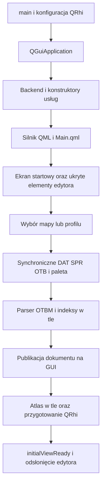

# Audyt uruchamiania i ładowania DME — 2026-10-27

> Raport historyczny sprzed refaktoryzacji. Stan po wdrożeniu: [2026-10-28](startup-implementation-2026-10-28.md).

## Wynik i zakres

Największy zmierzony koszt startu pustego narzędzia znajduje się w tworzeniu QML. Backend w pustym profilu zajmuje zwykle kilkanaście milisekund, a utworzenie pełnego UI około 2,3–3,5 s w opisanym niżej środowisku diagnostycznym. Przed otwarciem mapy powstaje również kilka kopii ukrytych paneli. Przygotowanie danych klienta stanowi osobny, synchroniczny etap GUI; parser mapy i dekodowanie atlasu mają już zadania w tle.

To **analiza bez zmian w działaniu lub wyglądzie aplikacji**. Dodano dokumentację, wyniki i osobny program diagnostyczny poza targetami aplikacji. Nie zmieniono produkcyjnych źródeł, CMake, QRhi ani istniejących testów. Raport dotyczy aktualnego, lokalnie zmodyfikowanego drzewa, nie wyłącznie opublikowanego wydania.

## Metoda i ograniczenia

Windows, istniejący Release, Qt 6.10.2 / MinGW 13.1.0; faktyczny standard repozytorium to C++17. Program diagnostyczny połączono z istniejącymi obiektami produkcyjnego DME i jego QRC, pomijając produkcyjny main.cpp. Sprawdzono 41 061 zależności obiektów DME/OTFormats: żadna nie była nowsza od odpowiadającego obiektu.

Pomiar używa pełnego Main.qml, rzeczywistych usług C++ i image providerów, bez mocków. **Offscreen/software mierzy tworzenie UI, nie czas natywnego okna ani gotowość mapy na GPU.** Nie zmieniono produkcyjnego renderera. Każda próbka to nowy proces, nowy profil UUID, izolowane ustawienia INI, recovery i dane testowe. Nie używano historii, kont Activity, map ani ustawień użytkownika. Sieć procesu diagnostycznego skierowano do własnego lokalnego listenera.

Wykonano po trzy próby wariantu, kolejno. Nie czyszczono cache systemu plików. Nie są to kontrolowane zimne starty dysku; mała próba nie uzasadnia rankingu szybkości motywów. Zarejestrowano cztery systemowe fonty Segoe UI/Verdana. Offscreen nadal zgłasza brak własnego domyślnego katalogu fontów; nie jest to dowód błędu fontów w natywnym DME.

`qmlCreateMs` obejmuje konstrukcję silnika/providerów i synchroniczne engine.load(Main.qml), wraz z Component.onCompleted. Nie obejmuje loadera DLL przed main, pełnej mapy ani GPU. Liczba obiektów oznacza osiągalne QObject i elementy drzewa wizualnego, bez podwójnego liczenia wskaźników; nie jest liczbą widocznych kontrolek ani wszystkich obiektów procesu. Working set obejmuje proces, nie tylko QML.

Obserwacji frameSwapped nie użyto jako wyniku czasu pojawienia się aplikacji. Przy 10 tys. sesji sygnał nie został zaobserwowany w 300-ms oknie obserwacji. Ten test nie potwierdza pierwszej gotowej klatki.

## Wyniki

Mediany trzech prób; w nawiasach zakres. MiB = bajty / 1 048 576.

| Scenariusz | Backend [ms] | Tworzenie UI [ms] | Working set UI [MiB] | Obiekty |
|---|---:|---:|---:|---:|
| Fluent Dark, pusta historia | 10,6 (10,4–26,2) | 2461,9 (2407,6–3474,2) | 118,1 | 15 306 |
| Tibia-UI, pusta historia | 9,3 (8,8–125,8) | 2337,8 (2296,1–2796,4) | 125,0 | 18 276 |
| Fluent Dark, 1000 sesji / 20 zadań | 66,1 (59,4–91,0) | 2542,7 (2496,6–2634,3) | 128,1 | 15 945 |
| Fluent Dark, 10 000 sesji / 20 zadań | 32,9 (32,3–65,8) | 3023,9 (2997,0–3231,6) | 197,5 | 15 945 |

Historia jest syntetyczna, identyczna między próbami danego wariantu. Względem pustej historii 10 tys. sesji daje około +562 ms mediany tworzenia QML i +79,5 MiB working setu. Niemonotoniczny czas konstruktora Backend pokazuje zmienność środowiska; nie należy z niego budować modelu kosztu parsowania JSON.

W każdym pustym wariancie znaleziono po **3 WorkTimerStatus, 3 WorkTimerTaskPanel i 3 ActivityDialog**, a także 1 AboutDialog i 1 NewMapDialog. Fluent miał 376 Loaderów, w tym 77 nieaktywnych. Samo visible:false nie zapobiega tworzeniu komponentu.

### Dane rzeczywistego klienta

Odczytano lokalny profil 10.98: 13 412 definicji DAT, 68 385 sprite'ów SPR, bez otwierania mapy i bez zapisu plików klienta. Synchroniczne ensureClientVersion zajęło **602,8 / 295,5 / 266,4 ms**; mediana 295,5 ms.

| Etap | Trzy próby [ms] | Znaczenie |
|---|---|---|
| DAT | 26 / 30 / 20 | Różnica dat_ready i client_profile_begin |
| SPR | 25 / 11 / 10 | Różnica spr_ready i dat_ready |
| OTB | 30 / 20 / 23 | Różnica otb_ready i spr_ready |
| palette_visibility | 373 / 149 / 144 | Miniaturki, skan widoczności i publikacja filtrów |
| Definicje edytora po palecie | około 139 / 83 / 67 | Różnica znaczników; tilesety, brushes, creatures, items XML i powiadomienia |

Sam visibility_scan wyniósł 370 / 147 / 141 ms. Globalny szczyt working setu procesu wzrósł podczas tego etapu z około 118 do 285 MiB; nie przypisuję całej różnicy samym miniaturkom. Atlas_decode=0 ms w tym scenariuszu **nie jest pomiarem atlasu mapy**: mapa nie była załadowana i nie sprawdzano jej uploadu GPU.

Dane bez lokalnych ścieżek i logów: [CSV](benchmarks/startup-results-2026-10-27.csv). Kod i odtwarzanie: [README diagnostyki](benchmarks/README-startup.md).

## Zweryfikowany przepływ

Diagram upraszcza nową mapę, recovery, ponowne użycie dokumentu i cache-hit profilu.

| Podsystem | Źródło / wejście | Zachowanie i własność |
|---|---|---|
| Proces / Qt | [editor/main.cpp:67](../../editor/main.cpp#L67) | Ustawienia vsync przed QGuiApplication, później Backend i engine na stosie. Engine niszczony przed Backend. Na Windows domyślny backend wybierany przez QSG_RHI_BACKEND nadal należy do QRhi. |
| Backend | [editor/core/backend.h:129](../../editor/core/backend.h#L129) | Usługi są polami; ich konstruktory wykonują się przed ciałem konstruktora Backend. |
| Dokumenty / recovery | [editor/core/documentmanager.cpp:22](../../editor/core/documentmanager.cpp#L22) | Inicjalizacja i wykrywanie recovery; dużych rzeczywistych katalogów recovery nie objęto pomiarem. |
| Work timer | [editor/core/worktimerservice.cpp:28](../../editor/core/worktimerservice.cpp#L28) | Synchroniczny odczyt JSON, timer 1 s i event filter. Destruktor zapisuje historię, także bez edycji w oknie. |
| Activity | [editor/core/activityservice.cpp:21](../../editor/core/activityservice.cpp#L21) | Storage QObject przenoszony do QThread; otwarcie SQLite wykonywane zleceniem do workera. Konstrukcja usługi nie oznacza gotowości bazy. |
| Kontrolery QML | [editor/qml/controllers/DocumentController.qml:71](../../editor/qml/controllers/DocumentController.qml#L71) | Odczyt recent files, konfiguracji profili i palet; profiles.load nie jest odczytem DAT/SPR. |
| Aktualizacje | [editor/qml/StartupWindow.qml:27](../../editor/qml/StartupWindow.qml#L27), [editor/core/updateservice.cpp:85](../../editor/core/updateservice.cpp#L85) | Ekran startowy wywołuje checkForUpdates; żądanie jest asynchroniczne. Nie znaleziono blokującego oczekiwania na odpowiedź w tym przepływie. |
| Klient | [editor/qml/controllers/ClientProfileController.qml:212](../../editor/qml/controllers/ClientProfileController.qml#L212) | OTFI/fingerprint/cache-hit albo synchroniczne DAT/SPR/OTB, miniaturki i definicje edytora. |
| Otwieranie mapy | [editor/qml/controllers/DocumentController.qml:157](../../editor/qml/controllers/DocumentController.qml#L157) | Nagłówek i przygotowanie klienta poprzedzają mapView.loadMap. |
| Parser / indeksy | [editor/map/mapview.cpp:190](../../editor/map/mapview.cpp#L190) | Osobny reader w std::thread, anulowanie i generacja, progres/wynik przez queued invocation. Dokument i indeksy przejmowane w GUI. |
| Atlas | [editor/map/mapview_atlas.cpp:103](../../editor/map/mapview_atlas.cpp#L103) | Worker ma własny SprReader; dekoduje potrzebne sprite'y, publikuje wynik do właściciela. |
| Gotowość widoku | [editor/map/mapview.cpp:360](../../editor/map/mapview.cpp#L360), [editor/qml/Main.qml:54](../../editor/qml/Main.qml#L54) | initialViewReady jest osobne od parsowania. editorPresented i opacity chronią przed odsłonięciem niedokończonego widoku. |

LoadProfile ma znaczniki backend_ready, qml_startup, renderer_index, atlas_decode, await_initial_view i first_complete_frame. Jego process_start jest zapisywany **wewnątrz main**, więc nie obejmuje Windows loadera/DLL: [editor/main.cpp:73](../../editor/main.cpp#L73).

## Problemy i zalecenia

### 1. Wysoki priorytet: ukryte panele powstają przed pierwszym użyciem

Trzy instancje timera pochodzą z różnych wariantów pasków: [editor/qml/components/DmeStatusBar.qml:43](../../editor/qml/components/DmeStatusBar.qml#L43), [editor/qml/components/MapWorkspace.qml:989](../../editor/qml/components/MapWorkspace.qml#L989). Każdy deklaruje własną historię, task panel i ActivityDialog: [editor/qml/components/WorkTimerStatus.qml:320](../../editor/qml/components/WorkTimerStatus.qml#L320), [editor/qml/components/WorkTimerStatus.qml:404](../../editor/qml/components/WorkTimerStatus.qml#L404). To powoduje konstrukcję i wiązania również dla nieużywanego wariantu UI.

Liczby obiektów potwierdza pomiar; **nie wykazano**, jaka część całych 2,46 s pochodzi wyłącznie z tych paneli. Zalecenie: jeden host popupu timera i Loader tworzący ciężką zawartość przy pierwszym otwarciu; ewentualnie aktywowanie wyłącznie paska używanego motywu. Zachować wygląd, fokus, Escape, dock/float i wszystkie funkcje. Zysk zmierzyć po pojedynczej zmianie.

### 2. Wysoki priorytet: pełna historia materializowana dla ukrytego UI

[editor/core/worktimerservice.cpp:113](../../editor/core/worktimerservice.cpp#L113) tworzy widoki wszystkich sesji przy każdym odczycie; [editor/core/worktimerservice.cpp:121](../../editor/core/worktimerservice.cpp#L121) agreguje historię od początku. [editor/core/worktimerservice.cpp:462](../../editor/core/worktimerservice.cpp#L462) parsuje cały plik w konstruktorze. Kilka bindingów pobiera taskTimers; historia jest modelem ListView także przed jego otwarciem. Stała liczba widocznych delegatów nie chroni przed kosztem pełnego QVariantList.

Zalecenie: najpierw nie pobierać historii przed otwarciem panelu. Następnie model historii udostępniający wiersze na żądanie i cache agregatów aktualizowany przy zmianie sesji. Nie usuwać zapisanych sesji w celu optymalizacji. Jeśli sam odczyt nadal blokuje start, parsować snapshot w tle i publikować w wątku właściciela, z ochroną przed późnym wynikiem i równoczesną edycją.

### 3. Wysoki priorytet: przygotowanie klienta blokuje GUI

[editor/qml/controllers/ClientProfileController.qml:245](../../editor/qml/controllers/ClientProfileController.qml#L245), [editor/core/backend.h:93](../../editor/core/backend.h#L93), [libs/otformats/sprreader.cpp:626](../../libs/otformats/sprreader.cpp#L626). Łańcuch ensureClientVersion jest synchroniczny z QML. Preloading składa miniaturki i skanuje piksele, przechowując obrazy. Ustawienie progresu wewnątrz tej samej długiej funkcji nie gwarantuje odmalowania kontrolki. W badanym profilu sam etap palety trwał 144–373 ms.

Zalecenie: wykorzystać istniejący wzorzec własnego readera/snapshotu w workerze; gotowy stan publikować na GUI. Nie wywoływać metod współdzielonego QObject z obcego wątku. Rozważyć priorytet widocznej kategorii i odroczone miniaturki, zachowując filtrowanie niewidocznych sprite'ów i rewizje obrazów. Fingerprint/cache-hit już istnieje — rozwijać go zamiast dublować.

### 4. Średni priorytet: widoki QML nie są kompilowane podczas badanego builda

[CMakeLists.txt:229](../../CMakeLists.txt#L229), [CMakeLists.txt:208](../../CMakeLists.txt#L208). Moduł Tibia rejestruje C++ przez SOURCES, widoki są w QRC bez QML_FILES. W sprawdzonym build.ninja brak reguł qmlcachegen. **Nie oznacza to braku cache dyskowego Qt** ani dowodu, że kompilacja QML wyjaśnia cały czas startu.

Zalecenie: ograniczony eksperyment z QML_FILES, poprawnymi aliasami i importami; sprawdzić wszystkie motywy, pakowanie, czysty cache i kolejne uruchomienia. Nie przenosić całego UI do innej architektury.

### 5. Średni priorytet: ostrzeżenie QML podczas ładowania

[editor/qml/dialogs/AdvancedBrushEditor.qml:60](../../editor/qml/dialogs/AdvancedBrushEditor.qml#L60) wywołuje globalne qt.qml.invalidOverride: Duplicate method name w każdym przebiegu. Lista QQmlEngine::warnings jest przy tym pusta — to inne źródło komunikatu. Nie zaobserwowano przerwania startu.

Zalecenie: usunąć kolizję nazwy metody i zweryfikować wszystkich wywołujących oraz załadowanie edytora brushy. Nie wprowadzałem poprawki w zadaniu analitycznym.

## Co zachować i co zmierzyć dalej

Zachować parser/indeksy w tle, własny reader atlasu, kolejkę SQLite, asynchroniczną sieć, fingerprint profilu i istniejące nieaktywne Loadery. Nie ma uzasadnienia dla wymiany renderera lub całej architektury.

Skompilowano diagnostykę i wykonano 15 pełnych przebiegów; wszystkie zakończyły się poprawnie i potwierdziły usunięcie własnych danych testowych. SHA-256 wszystkich 1080 plików początkowego spisu pozostał bez zmian. Nie powtarzano całej baterii regresyjnej aplikacji, ponieważ jej kod nie został zmieniony.

Niewykonane: czas od kliknięcia EXE do natywnego okna na ekranie, kontrolowany cold boot/cache/antywirus, duża prywatna mapa, pierwsza pełna klatka QRhi i upload GPU, wpływ rzeczywistych ustawień/recovery użytkownika. Nie ogłaszam przyspieszenia — to wartości bazowe i potwierdzona praca na ścieżce startu.

Zalecana kolejność: odroczenie popupów → ograniczenie materializacji historii → asynchroniczna paleta → eksperyment kompilacji QML. Każdy krok osobno, porównany w tym samym scenariuszu i sprawdzony na natywnym UI bez zmiany jego projektu graficznego.
