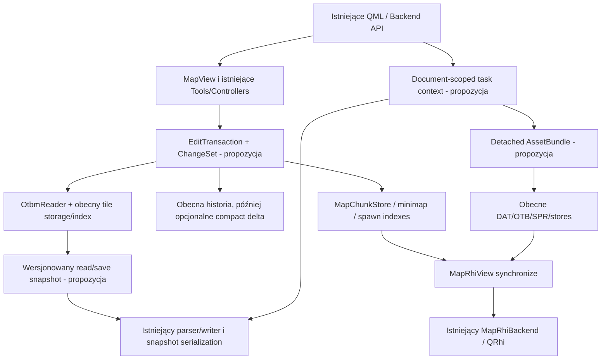

# Architektura docelowa — ewolucja, nie przepisanie

## Decyzje

- **QRhi, QQuickRhiItem i MapRhiBackend pozostają.** Nie tworzyć drugiego renderera ani nowej warstwy OpenGL/Vulkan/D3D/Metal.
- **UI i publiczne przepływy użytkownika pozostają.** Zmiany dotykają wnętrza usług i kontraktów zadań, nie projektu ekranów.
- **Deque + hybrydowy indeks są baseline'em.** Chunk-based storage nie jest nowym odkryciem: indeks i renderer już go stosują. Pełna wymiana storage nie ma obecnie wystarczającego dowodu benchmarkowego.
- **Nie tworzyć od razu kilkunastu nowych modułów.** Istniejące core/map/preview/otformats/QML mają użyteczne granice. Najpierw doprecyzować własność i zmiany danych.
- **C++20/23 nie rozwiązuje automatycznie problemów.** Build pozostaje C++17 do osobnego zadania migracyjnego. QPointer/epochs/QtConcurrent/RAII już występują i powinny zostać zachowane.

## Docelowy przepływ i odpowiedzialności

Nazwy poniżej oznaczone jako „propozycja” nie są istniejącymi API repozytorium.

## Granice proponowane

| Granica | Co zostaje | Co może się zmienić | Warunek wdrożenia |
|---|---|---|---|
| Map data / IO | OtbmTile/Item, OTBM wersje, deque/index, writer/reader | Checked position contract; później izolacja serializer state od QObject | Bounds + round-trip + unknown metadata/error tests |
| Editing / History | Konkretne algorytmy brush, stos itemów, undo user semantics | RAII transaction guard i jeden ChangeSet z positions/relocations/metadata | Te same wyniki i jedna akcja undo na istniejący gest |
| Queries / Jobs | Publiczne start/cancel i UI results | Captured document epoch, selection snapshot, immutable asset references, publication check | Switch/close/load/client-change podczas aktywnego zapytania |
| Recovery / Save | QSaveFile, backups, sidecar validation, dirty state | Snapshot per document version i background serialization; capture budget | Snapshot nie czyta mutującej mapy, save nie czyści nowych zmian |
| Assets | Zgodność DAT/SPR/OTB/OTFI i profile | Detached bundle i prepared thumbnails; budżet CPU/GPU osobno | Fail/cancel nie pozostawia mieszanego klienta |
| Rendering | Chunk versions, instancing, cache, order, shaders, QRhi | Scratch reuse, mniej zbędnych uploadów, ewentualnie SRB/state reuse | Metryka konkretnego workloadu i kontrola obrazu |
| Preview | Oddzielne okno/kamera/weather i własny renderer | Dirty rectangles atlasu i stabilne keys | Byte counters pokazują istotny churn; no stale sprites |
| Build | CMake/Qt registration/QRC/qsb, testy | Wspólny object/library target dla powielanych źródeł, poprawny minimum Qt | Identyczny pakiet i testy; brak niejawnych zależności |

Punkty wyjścia: [editor/core/backend.h:36](../../editor/core/backend.h#L36); [editor/map/mapservices.h:1](../../editor/map/mapservices.h#L1); [editor/map/mapeditcontroller.h:9](../../editor/map/mapeditcontroller.h#L9); [editor/map/maprhibackend.h:22](../../editor/map/maprhibackend.h#L22).

## Kontrakt zadania dokumentowego — propozycja

Task context identyfikuje dokument, generację jego danych, generację klienta, cancellation i wynik. Worker nie traktuje żywego `MapView::m_otbm` jako niezmiennego snapshotu. Wynik jest publikowany tylko, gdy kontekst nadal odpowiada żądaniu i dokumentowi.

Dwa warianty do pomiaru:
1. Pełny immutable snapshot: prosty kontrakt, ale koszt RAM/capture może być duży.
2. Czytanie ograniczonych fragmentów/chunk snapshots z kontrolą wersji: mniejszy peak, lecz trzeba zdefiniować spójność wyniku i regułę restartu/anulowania po mutacji. Nie akceptować „wyniku z kilku różnych wersji” jako pełnego snapshotu.

Nie wystarczy dodać QPointer do aktualnego kodu ani tylko usunąć mutex. Pointer chroni informację o lifetime, nie spójność danych i nie prawo dostępu do QObject w innym wątku. Nie zamieniać problemu na GUI waitForFinished przy każdej zmianie karty.

## Kontrakt edycji — propozycja

EditTransaction ma jednoznacznego właściciela i definiuje nesting, commit/abort i publikację. ChangeSet wskazuje dotknięte pozycje, relokacje tile, zmiany metadata i zależne indeksy. Pierwszy etap opakowuje obecną historię snapshotową; nie wymaga nowego virtual Command per item.

Abort przed commit nie może uszkodzić stack order ani zgubić grupy zewnętrznej. Gdy operacja nie gwarantuje rollback przy OOM, kontrakt powinien to jasno deklarować, a nie deklarować silną exception guarantee bez implementacji. Przejście na delta records zaczynać od prostej flagi/licznika, pozostawiając snapshot fallback dla children/structural changes.

## Kontrakt zapisu i recovery — propozycja

Snapshot ma source document/version i zachowuje wszystkie metadata. Worker zapisuje tylko snapshot. GUI oznacza dokument jako czysty wyłącznie wtedy, gdy zapisana wersja jest nadal aktualna; w przeciwnym razie pozostaje dirty. Zamknięcie, nowy zapis, anulowanie i zmiana ścieżki nie mogą opublikować starego wyniku.

Dla sidecars: obecny QSaveFile/rollback zostaje; dodatkowy journal/crash recovery rozważać osobno i z injection failures. Background save nie może jednocześnie podmieniać żywych metadata i gubić nowych zmian.

Źródła stanu obecnego: [libs/otformats/otbmreader.cpp:3514](../../libs/otformats/otbmreader.cpp#L3514); [libs/otformats/otbmreader.cpp:3639](../../libs/otformats/otbmreader.cpp#L3639); [editor/core/documentmanager.cpp:26](../../editor/core/documentmanager.cpp#L26).

## Budżety i duże mapy

Mierzyć osobno: live tile/item, indeks pozycji, indeks renderera, quad snapshots, historia, recovery snapshot, asset thumbnails/atlas, CPU staging i GPU textures/cache. Ograniczenie LRU nie gwarantuje ograniczenia procesu, gdy odbiorca trzyma shared_ptr lub pojedyncza akcja przekracza limit. Nie usuwać historii ani sprite'ów potrzebnych do poprawnego obrazu tylko po to, by spełnić arbitralny limit.

Proponowany model docelowy to nadal sparse world z gęstymi lokalnymi regionami. Dense patch może służyć bulk computation, lecz commit przechodzi przez sprawdzony adapter do obecnego readera. Gdy rozważany jest chunk-owned map storage, wymagane są jednocześnie: przewaga na rzeczywistych scenach, stable handles/observer strategy, serializer iterator, kompatybilne undo, region queries, zachowanie metadanych i łatwe cofnięcie zmiany. Mikrobenchmark samego lookup nie jest wystarczający.

## Czego świadomie nie proponuję

Nowego ECS, globalnego service locatora, plugin architecture dla każdego toola, bezwarunkowego SoA, memory poola dla wszystkich obiektów, nowych frameworków testów, wspólnych natywnych uchwytów GPU między oknami ani big-bang migracji C++23. Każdy z tych kroków wymagałby odrębnego problemu i dowodu przewagi.

Kolejność realizacji i rollback: [migration-roadmap.md](migration-roadmap.md). Powyższe granice są projektem do walidacji, nie opisem już wdrożonej architektury.
